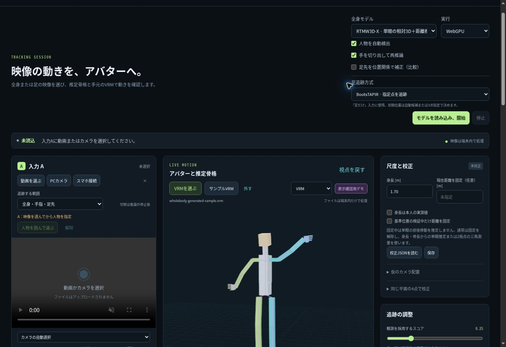

# フェーズ3の測定範囲
## 公開モデルと実行記録
圧縮配布を含む公開入力での実推論は[Actions run 41389867024](https://github.com/DaisukeDaisuke/Wholebody-test/actions/runs/41389867024)で通過した。計算コードのソースは `985542a1021add7595819689ebd0dbfde66574d3`。Sitesの `dist/delivery.json` は配布物の由来を記録する。実測JSONは配布アプリのActions実測欄へ同梱する。
BootsTAPIRは[変換run 41384892970](https://github.com/DaisukeDaisuke/Wholebody-test/actions/runs/41384892970)で3つのONNXへ変換した。Google公式実装との参照比較と固定画像の前後処理比較を通過した重みを、[公開run 41385853154](https://github.com/DaisukeDaisuke/Wholebody-test/actions/runs/41385853154)から[Foot-Point-Tracker-onnx](https://huggingface.co/RabbitDaisuke/Foot-Point-Tracker-onnx)へ公開した。ライセンスはApache-2.0。
manifestの固定revisionは `ac66a7e5df280cb9986a417de79bc2c1b997c233`、重みの固定revisionは `4751f96d5413e48c05e63da133a5b4b1e6074c12`。モデルはencoder 115,330,894 bytes、query 2,291 bytes、step 105,305,753 bytes。アプリは各ファイルのSHA-256を検査する。
Sitesの1ファイル25 MiB上限に合わせ、28,747,738 bytesのORT 1.31.1 Asyncify WASMはgzipで配布する。圧縮状態で届いた場合は圧縮ファイルと復元後のbytes・SHA-256を照合し、HTTP層ですでに展開された場合も元WASMのbytes・SHA-256を照合する。復元した同一WASMを `env.wasm.wasmBinary` に渡すため、モデル・演算・数値精度は変えない。Sites版とローカル配布版は同じ形式を使う。
## 実モデルと変換の確認
RTMW3D-XとFOCUSは公開のCOCO画像785を実際にWASMで処理した。全身133点・相対深度・足候補を出荷する復号処理へ通した。人物枠は以前のYOLOX出力で、正解BBoxではない。この単一画像のデータ経路確認から、全身3Dの精度や足候補の正答率は主張しない。
BootsTAPIRの出荷コードは[run 41385890985](https://github.com/DaisukeDaisuke/Wholebody-test/actions/runs/41385890985)で、実ONNX Runtime Web/WASMの3グラフを使って初期化・再帰更新・2入力の状態分離・reset・disposeを実行した。公開静止画の同じRGBを時刻だけ変えて入力し、公式参照との座標最大差は `0.0000763 px`、可視判定の不一致は0だった。これは変換・実装の一致度で、実動画の位置誤差ではない。
同runの単一スレッドWASMは再帰更新1回あたり約2,966〜3,001 msだった。実時間動作の条件は満たしていない。推論完了後に次の時刻へ進む順送り解析と、最新フレームを処理する通常再生を分けて提供する。
## VRMとローカル送出
生成したVRM 1.0を本番ローダで開き、normalized humanoidの回転がrawボーンとスキン頂点へ伝わること、欠測時の復帰、足だけの入力で未観測の上半身を動かさないことをActionsで確認した。サンプルは52人体ボーン・1スキンメッシュ・1,248頂点で、本人の映像や外部配布モデルは使わない。
ローカルブリッジでは11条件を実行し、WebSocket入力から15個のOSC UDPパケットを実受信した。座標の符号、四元数、古い位置の無効化、接続終了時の無効化、相対位置を絶対位置として送らないことを確認した。SteamVR・VMT・VRChatの実機は起動していない。
クラウドブラウザではWebGLが利用できなかったため、実スキン頂点をCanvas 2Dへ投影するCPU簡易描画を実装した。自作VRMの全624面と、明示的な人工動作による46ボーンの反映を画面で確認した。この確認は表示機能の検証であり、映像認識の精度ではない。

画像内の紫の表示は人工動作のデモを示す。ユーザーの動画や外部配布モデルはこの画面に含まない。
## WebGPUの確認方法
専用Actionsは公開画像と固定モデルだけを使い、Dedicated Worker内で3つのWebGPUセッションを起動する。query特徴と再帰状態のGPUバッファ保持・更新、最終座標と公式参照の差を記録する。SwiftShaderはCPUでWebGPU演算を実装するため、このjobの時間を物理GPUのfpsとして報告しない。
最初の実行でORT Web 1.22.0のquery側GridSampleに失敗し、ORT Web 1.31.1と対応するAsyncifyランタイムへ更新した。[run 41387575983](https://github.com/DaisukeDaisuke/Wholebody-test/actions/runs/41387575983)では3グラフの実行、GPU上のquery特徴と再帰状態の保持・更新、公式参照比較、3セッションの解放が成功した。座標の最大差は0.000114441px、可視判定の相違は0/3点、外部リクエストとGPUエラーは0だった。
このWebGPU実行はSwiftShaderで、初期化フレーム約143秒・更新フレーム約135秒だった。GPU投入が非同期であるため、APIで囲ったencoder/stepの所要時間は個別GPUカーネル時間ではない。一部の演算はCPUへ割り当てられるため、全演算がGPU上で実行されたとも主張しない。物理GPUの推論速度は未測定。
同じ1.31.1構成の[core run 41387576005](https://github.com/DaisukeDaisuke/Wholebody-test/actions/runs/41387576005)でも実WASMを再確認した。2回の更新は約1,831msと1,708ms、公式参照との座標最大差0.000114441px、可視判定の相違0だった。以前の1.22.0とは別runnerの測定であり、版更新だけによる速度改善率とは扱わない。
再実行に期限付きartifactを必要としないよう、公開参照JSONをリポジトリに保存し、元の公開JPEGを同じ固定版OpenCVで復号してRGBのSHA-256一致を確認する。モデルはアプリと同じHugging Face固定revisionから取得する。
この恒久的な準備経路を使った[run 41388182911](https://github.com/DaisukeDaisuke/Wholebody-test/actions/runs/41388182911)も通過した。座標差・可視判定は前runと同じで、SwiftShaderでは初期化約104秒・更新約98秒だった。
gzip配布経路は[run 41389867022](https://github.com/DaisukeDaisuke/Wholebody-test/actions/runs/41389867022)で確認した。7,131,690 bytesの圧縮WASMはcore配布物と完全一致し、ブラウザWorkerで圧縮データ・復元後WASMの両SHA-256を検証した。未圧縮WASMへのリクエストは0、外部リクエストとGPUエラーも0、3グラフとGPU上の状態保持・更新は成功した。公式参照との座標最大差は0.000114441px、可視判定の相違は0。SwiftShaderの初期化は約104秒・更新は約96秒で、物理GPUの速度ではない。配布アプリの `evaluation/phase3-webgpu.json` はこのrunの実測を保存する。
## 実動画の精度に関する境界
点追跡は初期点の意味を自分で識別しない。母趾先・小趾先・踵中心は初期検出または手動指定で定義する。画像上の対応が続くことと、隠れた5本の足指の3D関節を推定できることは別の達成条件である。
初期ROIの拡大は比較機能で、回転・大移動で範囲を外れうるため既定OFF。可視性の低い点を常に観測座標へ変換しない。足だけの結果に奥行きや全身位置を加えず、VRM反映も初期角度からの画像平面内変化に限定する。
私有動画・派生画像・正解注釈・トレースは公開成果物に含まない。個人映像の定量比較は依頼者へ直接報告し、公開モデルの学習データにも混ぜていない。
## 一次資料
- [Google TAPnet / BootsTAPIR](https://github.com/google-deepmind/tapnet)
- [Google公式PyTorch重み](https://huggingface.co/google/tapnet)
- [ONNX Runtime WebGPUのGPUバッファ](https://onnxruntime.ai/docs/tutorials/web/ep-webgpu.html)
- [ONNX RuntimeのWASMバッファ指定](https://onnxruntime.ai/docs/api/js/interfaces/Env.WebAssemblyFlags.html#wasmbinary)
- [ORT WebGPUの5次元Einsum修正](https://github.com/microsoft/onnxruntime/pull/27779)
- [three-vrm API](https://pixiv.github.io/three-vrm/docs/)
